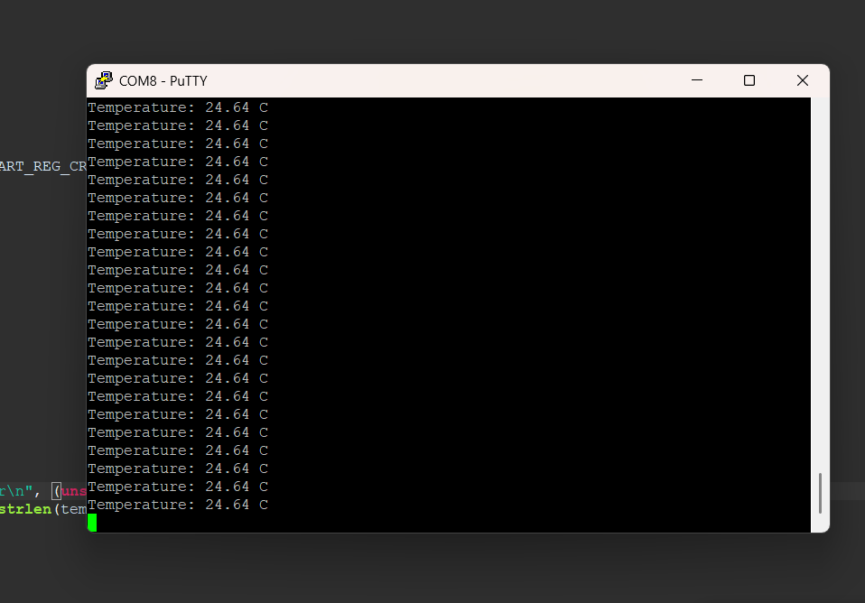

# STM32F429 LM35 Temperature Monitor: Bare-Metal ADC and UART Drivers

A temperature measurement system on the **STM32F429ZIT6** built with **register-level drivers** (no STM32Cube HAL code). An **LM35** analog sensor is read through the ADC, converted, and sent over **USART1** at 9600 baud using **interrupt-driven transmission**.

The goals of the project are to understand peripheral programming at register level, interrupt handling with the NVIC, and how to structure reusable drivers.

> **Note on design:** the driver API, state names (`READY`, `BUSY_TX`, ...) and error codes are modelled on ST's HAL architecture. All register-level code was written by hand from the reference manual (RM0090).

---

## Hardware and Tools

| Item | Detail |
|---|---|
| MCU | STM32F429ZIT6 (Cortex-M4) |
| Sensor | LM35 analog temperature sensor (10 mV/°C), connected to **PA0** |
| Serial | USART1, **PA9** (TX) / **PA10** (RX), AF7, 9600 8N1 |
| IDE | STM32CubeIDE (GCC toolchain) |
| Terminal | PuTTY or any serial monitor |
| Debug LED | PG13 (error indication) |

### Clock configuration

The code does **not** configure the PLL, so the MCU runs on the default **HSI at 16 MHz**. With the reset RCC settings, AHB, APB1 and APB2 all run at 16 MHz.

| Clock | Value |
|---|---|
| SYSCLK / HCLK | 16 MHz (HSI) |
| PCLK2 (USART1, ADC1) | 16 MHz |
| ADC clock (PCLK2 / 4) | **4 MHz** |

---

## Project Structure

```
├── Src/
│   ├── main.c          # Application loop, USART1 GPIO setup, USART1_IRQHandler
│   ├── ADC_HAL.c       # ADC1 driver
│   └── UART_HAL.c      # USART driver
├── Inc/
│   ├── ADC_HAL.h
│   ├── USART_HAL.h     # USART types, bit definitions, NVIC/RCC/GPIO register maps
│   ├── GPIO_HAL.h
│   └── Common_BASES.h
├── Startup/            # Startup code and vector table
├── STM32F429ZITX_FLASH.ld / STM32F429ZITX_RAM.ld
└── README.md
```

---

## Application Flow

1. Initialize USART1 pins (PA9/PA10, AF7), the UART driver, the NVIC and the ADC.
2. Start an ADC conversion on channel 0 (PA0).
3. Poll the **EOC** flag until the conversion finishes.
4. Read the 10-bit result (0 to 1023).
5. Convert the value and format it with `sprintf` into a global buffer.
6. Start an interrupt-driven UART transmission of the string.
7. Wait about 1 second (software delay loop).
8. Repeat.

---

## ADC Driver (`ADC_HAL`)

| Setting | Value |
|---|---|
| Resolution | 10-bit (`CR1.RES = 01`), range 0 to 1023 |
| Prescaler | PCLK2 / 4 (`CCR.ADCPRE = 01`), ADC clock 4 MHz |
| Sample time | 3 cycles (`SMPR2.SMP0 = 000`) |
| Sequence | 1 conversion, channel 0 on PA0 (analog mode) |
| Mode | `CONT = 1`, `SCAN = 1`, `EOCS = 1`, polling (EOC interrupt disabled) |

```c
void     HAL_ADC_Init(void);
void     HAL_ADC_Start(uint8_t channel);
void     HAL_ADC_WaitForConversion(void);   // blocks until SR.EOC is set
uint16_t HAL_ADC_Get_Value(void);
```

### ADC timing

In 10-bit mode a conversion takes `sample time + 10` cycles:

```
3 + 10 = 13 ADC cycles = 13 / 4 MHz = 3.25 µs
```

### Resolution

```
1 LSB = 3.3 V / 1023 ≈ 3.2 mV  ≈ 0.32 °C   (LM35: 10 mV/°C)
```

The real resolution is therefore about 0.3 °C, so one decimal place is the meaningful precision. Using 12-bit mode and averaging would improve it.

---

## UART Driver (`UART_HAL`)

Interrupt-driven TX and RX with a central interrupt handler.

| Setting | Value |
|---|---|
| Baud rate | 9600 |
| Word length / stop bits / parity | 8 / 1 / none |
| Oversampling | 16x |
| Bus | USART1 is on **APB2** (16 MHz here) |

```c
void hal_uart_init(uart_handle_t *handle);
void hal_uart_tx(uart_handle_t *handle, uint8_t *buffer, uint32_t len);   // non-blocking
void hal_uart_rx(uart_handle_t *handle, uint8_t *buffer, uint32_t len);   // non-blocking
void hal_uart_handle_interrupt(uart_handle_t *huart);                    // call from USARTx_IRQHandler
```

### Baud rate register

BRR is written from a constant table valid **for a 16 MHz PCLK only**:

```
USARTDIV = 16 000 000 / (16 × 9600) = 104.1667
Mantissa = 104 (0x68), Fraction = round(0.1667 × 16) = 3  ->  BRR = 0x0683
```

### Interrupt path

```
USART hardware event
   -> NVIC (IRQ 37 for USART1)
   -> USART1_IRQHandler()            (defined in main.c, one line)
   -> hal_uart_handle_interrupt()    (reads SR, checks flag AND enable bit)
   -> TXE / TC / RXNE sub-handlers
```

`NVIC_ENABLE_IRQ(USART1_IRQ_NUM)` is called in `main()` after `hal_uart_init()`. No priority is set, so the default priority 0 is used.

| Peripheral | IRQ | ISR name |
|---|---|---|
| USART1 | 37 | `USART1_IRQHandler` |
| USART2 | 38 | `USART2_IRQHandler` |
| USART3 | 39 | `USART3_IRQHandler` |
| UART4 | 52 | `UART4_IRQHandler` |
| UART5 | 53 | `UART5_IRQHandler` |
| USART6 | 71 | `USART6_IRQHandler` |

### Transmission sequence

1. `hal_uart_tx()` stores the buffer pointer and length, sets `tx_state = BUSY_TX`, clears TC, and **enables the TXE interrupt**. It returns immediately.
2. **TXE** means the *data register* is empty (its content moved to the shift register). The TXE handler writes the next byte to `DR`, which clears TXE.
3. After the last byte is loaded, the handler **disables TXE and enables TC**.
4. **TC** means the shift register has also finished, so the complete frame including the stop bit has left the pin. The TC handler disables TC, sets `tx_state = READY` and calls the TX-complete callback if one is registered.

```
READY --hal_uart_tx()--> BUSY_TX --(TXE x N)--> BUSY_TX (waiting for TC) --TC--> READY
```

### Reception sequence

`hal_uart_rx()` sets `BUSY_RX` and enables RXNE, PEIE and EIE. Each RXNE interrupt reads `DR` into the buffer (masked to 7 bits if parity is used). When the requested length is reached, the interrupts are disabled, the state returns to `READY` and the RX-complete callback is called.

### Error handling

PE, FE, NE and ORE are checked in `hal_uart_handle_interrupt()`. A flag is cleared by reading `SR` then `DR`. The error is OR-ed into `ErrorCode`, and the TX/RX states are reset to `READY`. The error callback `hal_uart_error_cb()` then runs.

| Error | Flag | Enable bit |
|---|---|---|
| Parity | PE | `CR1.PEIE` |
| Framing | FE | `CR3.EIE` |
| Noise | NE | `CR3.EIE` |
| Overrun | ORE | `CR3.EIE` |

> `hal_uart_error_cb()` is **not** a registered callback: it is a fixed handler that blinks the LED on PG13 in an endless loop. A UART error therefore halts the application. `EIE`/`PEIE` are enabled only inside `hal_uart_rx()`, which this application does not call, so error interrupts are inactive in this demo.

### Timing

```
9600 baud -> 104.17 µs per bit
10 bits per frame (1 start + 8 data + 1 stop) -> 1.04 ms per character
"Temperature: 25.00 C\r\n" (22 characters) -> about 22.9 ms
```

---

## Temperature Conversion

The LM35 outputs **10 mV per °C**.

Current code:

```c
temperature_C = (ADC_value * 3300) / 1023;   // millivolts at the pin
Temp_int = temperature_C / 100;
Temp_dec = temperature_C % 100;
```

`temperature_C` is actually the **pin voltage in millivolts**. See *Known limitations* for the correct scaling.

Output format: `Temperature: XX.YY C`

---

## Register Quick Reference

### USART

| Register | Notes |
|---|---|
| `SR` | TXE bit 7, TC bit 6, RXNE bit 5, ORE bit 3, NE bit 2, FE bit 1, PE bit 0 |
| `DR` | TX/RX data |
| `BRR` | 0x0683 for 9600 baud at **16 MHz** PCLK |
| `CR1` | UE 13, M 12, PCE 10, PS 9, PEIE 8, TXEIE 7, TCIE 6, RXNEIE 5, TE 3, RE 2 |
| `CR2` | STOP bits [13:12] |
| `CR3` | EIE bit 0 |

### ADC1

| Register | Notes |
|---|---|
| `SR` | EOC bit 1, STRT bit 4, OVR bit 5 |
| `CR1` | RES [25:24], SCAN bit 8, EOCIE bit 5 |
| `CR2` | ADON bit 0, CONT bit 1, EOCS bit 10, SWSTART bit 30 |
| `SMPR2` | SMP0 [2:0] (000 = 3 cycles, 001 = 15, 010 = 28, 011 = 56) |
| `SQR1` | Sequence length L [23:20] |
| `SQR3` | First conversion SQ1 [4:0] |
| `CCR` (common) | ADCPRE [17:16] |

---

## Troubleshooting

**No UART output**
1. USART1 clock enabled: `RCC->APB2ENR` bit 4.
2. PA9 and PA10 set to alternate function 7.
3. `BRR` matches the real PCLK2 (0x0683 only at 16 MHz).
4. NVIC IRQ 37 enabled and `USART1_IRQHandler` present in the vector table.
5. Probe PA9 with an oscilloscope or logic analyzer.

**ADC reads 0 or maximum**
1. PA0 in analog mode (`MODER[1:0] = 11`).
2. ADC clock enabled and `ADON` set.
3. Conversion started: check `SR.STRT`.
4. Sensor powered and ground shared with the board.

**Garbled serial data**
1. Terminal set to 9600 8N1.
2. Confirm the real clock: a wrong PCLK shifts the baud rate.
3. Check the USB-serial adapter and wiring.

---

## Expected Output



A new line appears about every second.

---

## Known Limitations and Planned Improvements

- **Temperature scaling:** the code divides millivolts by 100, but the LM35 gives 10 mV/°C, so the printed value is 10 times too small. The correct form is `tenths_C = (ADC_value * 3300U) / 1023U / 1U;` (1 mV = 0.1 °C), printed as `%u.%u` with one decimal.
- **Error callback:** it is hard-coded and halts the system. The planned design is to record the error, abort the transfer and call a registered callback.
- **`hal_uart_tx()`:** it does not check for `BUSY_TX` and has no return value. A call with `len == 0` would underflow the counter. A planned fix is to return `OK`/`BUSY`/`ERROR`.
- **Stop-bit configuration:** the mask `USART_REG_CR2_STOP_Bit` is used as a shift count, so the field is never actually written. Only the reset value (1 stop bit) works.
- **Baud rate:** a constant table valid only at 16 MHz. A better design computes `BRR` from `PCLK2` and the requested baud rate.
- **Shared state:** `tx_state`, `rx_state` and the transfer counters should be `volatile`.
- **ADC:** continuous mode is enabled although conversions are triggered once per loop, and scan mode is unnecessary for one channel. Single-conversion mode would be cleaner. A longer sample time would also improve accuracy.
- **Timing:** the 1-second delay is an uncalibrated busy loop. A SysTick or timer-based delay is planned.
- **Range and resolution:** about 0.32 °C per LSB, and 0 to 150 °C uses under half of the ADC range.

---

## References

- STM32F429 Reference Manual (RM0090)
- STM32F429 Datasheet
- ARM Cortex-M4 Generic User Guide
- LM35 Precision Centigrade Temperature Sensors Datasheet
